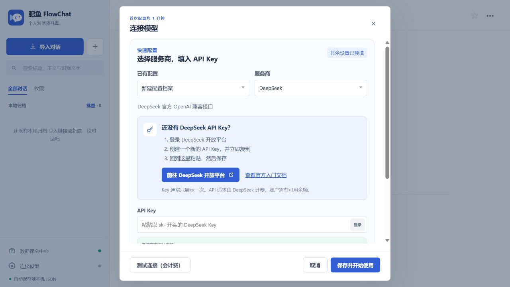
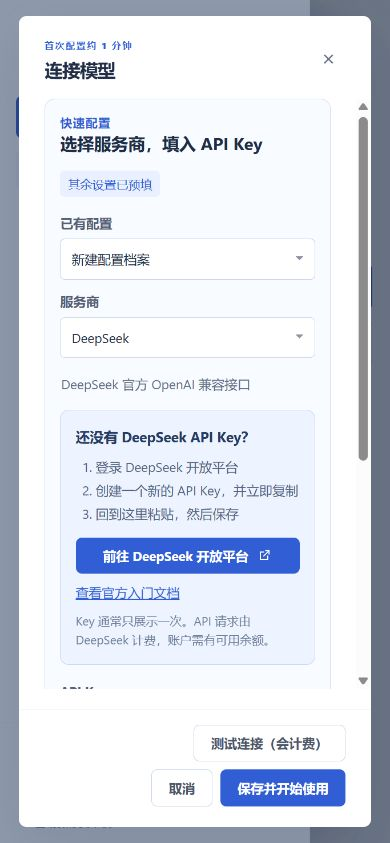
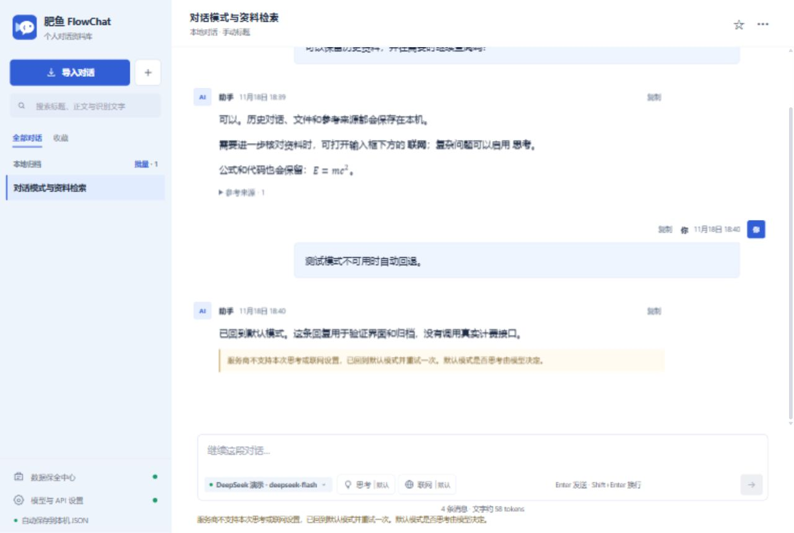
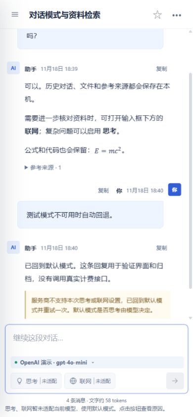

# 肥鱼 FlowChat

肥鱼 FlowChat 是一个本地运行的 DeepSeek 历史对话续聊与数据保全工具。它可以读取公开的 DeepSeek 分享链接，转换为 OpenAI Chat Completions 兼容归档，再通过用户自己的兼容 API 继续多轮对话。

项目重点不是简单复制聊天文字，而是同时保留原始响应、可续聊消息、历史版本和完整备份，让长期对话不再依赖单个平台的在线保留期限。

## 界面预览



<details>
<summary>查看移动端快速配置</summary>



</details>

<details>
<summary>查看对话与思考、联网模式</summary>





</details>

## 文档

- [使用教程](docs/USER_GUIDE.md)：安装、模型配置、导入、续聊、备份恢复与常见问题
- [开发文档](docs/DEVELOPMENT.md)：架构、数据模型、API、SSE、备份格式、测试和扩展指南
- [思考、联网与回退](docs/API_MODES.md)：按钮用法、厂商适配表、计费说明和官方 API 依据

## 已开发功能

当前版本已完成从“历史对话导入”到“本地长期保全与继续对话”的完整流程：

- DeepSeek 分享链接导入、去重、原始响应留存，以及图片、文件和公开 OCR 内容归档；
- OpenAI 兼容 JSON 导入导出、模型生成标题、全文检索、收藏、标签、文件夹与批量整理；
- 多厂商 OpenAI 兼容 API、多配置档案、系统凭据库保存 Key、模型列表与计费提示明确的连接测试；
- Markdown、代码、表格和 LaTeX 渲染，左右分栏消息，桌面端与移动端蓝白响应式界面；
- 思考与联网开关、厂商参数适配、不可用时自动回退默认模式，并保存回退说明与联网来源；
- 原子写入、历史版本、回收站、健康检查、完整 ZIP 备份、自动备份与校验恢复；
- DeepSeek 开放平台直达入口、三步 Key 申请说明，以及“服务商 + Key”两项式首次配置。

### 导入与续聊

- 单个或批量导入 `https://chat.deepseek.com/share/...`
- 自动检测重复分享链接
- 保留消息、思考过程、时间戳及 DeepSeek 来源元数据
- 使用任意 OpenAI Chat Completions 兼容服务继续对话
- 流式显示回答和思考内容，中止时尽量保存部分回复
- 蓝白界面，输入框底部提供思考与联网开关；明确不兼容时回到默认模式并最多重试一次
- 联网来源与回退说明随回复归档，切换模型时按已核验的能力启用开关
- 支持完整历史或最近 N 条消息两种上下文模式
- 安全渲染 Markdown、代码块、表格及 LaTeX/MathML 数学公式

### 标题

- 导入或首轮续聊时，优先使用当前请求模型生成具体标题
- 标题请求是独立模型请求，可能产生少量费用
- 只有模型未配置、不可访问或返回异常时，才使用第一句用户消息
- 支持手动重命名，并记录标题来源

### 本地数据保全

- OpenAI 兼容 JSON 归档
- DeepSeek 完整原始响应及 SHA-256
- 原子文件写入
- 覆盖前自动保留历史版本，每个对话最多 50 个
- 可恢复回收站和需要再次确认的永久删除
- 数据健康检查及部分自动修复
- 完整 ZIP 备份、manifest 校验、自动备份和三种恢复冲突策略

### 资料管理

- 标题、消息正文、标签和文件夹全文搜索
- 收藏、置顶、标签、文件夹
- 批量整理和批量回收
- OpenAI 兼容 JSON 导入与带标题的 JSON 导出

### 模型与密钥

- DeepSeek、OpenAI、SiliconFlow、阿里云百炼、OpenRouter、Ollama 和自定义接口预设
- 多个模型配置档案
- API 连接测试和兼容 `/models` 列表读取
- API Key 存入操作系统凭据库，不进入浏览器、本地 JSON、对话归档或备份

## 获取 DeepSeek API Key

只导入、阅读和导出历史对话不需要 API Key。需要继续对话时，按下面三步完成配置：

1. 打开 [DeepSeek 开放平台的 API Key 页面](https://platform.deepseek.com/api_keys) 并登录；
2. 创建一个新的 API Key，生成后立即复制；
3. 回到肥鱼 FlowChat，点击左下角“连接模型”，选择 DeepSeek，粘贴 Key 后点击“保存并开始使用”。

Key 通常只展示一次，不要把它发给他人或写入对话。肥鱼 FlowChat 会优先把 Key 保存到操作系统凭据库。DeepSeek API 按实际使用计费，账户需要有可用余额；模型和价格以 [DeepSeek 官方定价](https://api-docs.deepseek.com/quick_start/pricing/) 为准。

## 快速开始

需要 Python 3.10 或更高版本。

Windows 用户在项目目录运行：

```powershell
.\run.ps1
```

脚本会创建虚拟环境、安装依赖、启动本地服务并打开 <http://localhost:8000>。

端口冲突时：

```powershell
.\run.ps1 -Port 8080
```

手动启动：

```powershell
python -m venv .venv
.\.venv\Scripts\Activate.ps1
python -m pip install -r requirements.txt
python -m uvicorn app.main:app --host 127.0.0.1 --port 8000
```

首次使用只需：

1. 点击“导入 DeepSeek 对话”，粘贴分享链接并导入到本机；
2. 需要续聊时，再点击“连接模型”并粘贴 API Key；
3. 定期在“数据保全中心”下载完整备份。

详细步骤和字段解释见 [使用教程](docs/USER_GUIDE.md)。

## 界面与运行方式

前端由本机 FastAPI 直接提供，无需 Node.js 构建工具。默认只监听 `127.0.0.1`，页面通过 `localhost` 打开。

不要直接把服务监听到公网或局域网。当前安全模型面向单机单用户；开放网络访问前需要额外实现认证、HTTPS、限流和数据隔离。

## 数据目录

默认数据位于项目的 `data/`：

```text
data/
├─ archives/                 # 当前 OpenAI 兼容归档
│  └─ .trash/               # 回收站
├─ raw/                      # DeepSeek 完整原始响应
├─ versions/<对话 ID>/      # 覆盖前版本
├─ attachments/             # 附件保留目录
├─ backups/                 # 页面创建的备份
├─ provider_profiles.json   # 不含 API Key 的模型配置
└─ settings.json            # 自动备份设置与状态
```

使用其他目录：

```powershell
$env:FLOWCHAT_DATA_DIR = "D:\FlowChatData"
.\run.ps1
```

归档核心结构：

```json
{
  "format": "openai-chat-completions",
  "version": "1.2",
  "id": "...",
  "title": "模型生成的具体标题",
  "title_info": {
    "method": "model",
    "provider": "deepseek",
    "model": "deepseek-chat"
  },
  "source": {
    "type": "deepseek_share",
    "raw_snapshot": {
      "path": "raw/<id>.json",
      "sha256": "..."
    }
  },
  "messages": [
    {"role": "user", "content": "你好"},
    {"role": "assistant", "content": "你好，有什么可以帮你？"}
  ],
  "message_metadata": [
    {"id": "...", "created_at": "..."},
    {"id": "...", "created_at": "...", "reasoning_content": "..."}
  ]
}
```

`messages` 可用于 OpenAI 兼容请求；时间戳、思考过程和来源细节放在位置对应的 `message_metadata` 中，不会被意外发送给模型。

## 备份与恢复

完整备份包含当前归档、回收站、原始响应、版本、附件和不含密钥的配置。ZIP 内的 `manifest.json` 记录每个文件的大小和 SHA-256。

恢复前会先验证：

- 路径安全；
- ZIP CRC；
- 备份格式版本；
- 重复或清单外文件；
- 每个文件的大小与 SHA-256。

全部验证成功后才开始写入。支持跳过已有、另存副本、保留版本后替换三种策略。

备份不包含操作系统凭据库中的 API Key。迁移到新电脑后需要重新输入密钥。

## API 调用与费用

以下功能会真实调用用户选择的模型服务商：

- 正常聊天；
- API 连接测试；
- 模型生成归档标题。

测试请求最多输出 16 tokens；标题请求最多输出 32 tokens。两者都不会写成对话消息，但仍可能产生服务商费用。

## 开发与测试

安装开发依赖：

```powershell
python -m pip install -r requirements-dev.txt
```

运行检查：

```powershell
python -m compileall app
node --check static\app.js
python -m pytest -q
```

开发时建议使用隔离数据目录：

```powershell
$env:FLOWCHAT_DATA_DIR = "$env:TEMP\feiyu-flowchat-dev"
python -m uvicorn app.main:app --host 127.0.0.1 --port 8000 --reload
```

模块职责、HTTP API、SSE 事件、备份协议和扩展提供商的方法见 [开发文档](docs/DEVELOPMENT.md)。

## 安全说明

- DeepSeek 分享链接本身可以访问对话内容，应当视为敏感凭据；
- 不要把含隐私、密码、密钥或商业机密的分享链接交给无关人员；
- API Key 不写入本项目普通文件，但模型服务商仍会按其政策处理请求；
- 附件仅从已验证的 DeepSeek 文件域名自动下载，受限文件保留元信息和失败原因；
- 自动备份仅在程序运行期间执行；
- 执行永久删除前应确认已有可用备份。

## 项目状态

当前版本：`0.5.1`

### 0.5.1 更简单的首次配置

- 连接模型默认只显示服务商和 API Key，其他参数收进“更多设置”。
- DeepSeek 配置页提供官方开放平台直达入口和三步 Key 申请说明。
- 简化导入提示、按钮文字和首次使用教程，明确阅读与导出无需 API Key。

### 0.5 模式开关与兼容回退

- 输入框底部增加思考、联网开关，依据服务商和模型映射官方参数。
- 明确的模式不兼容错误最多回退一次，保存回退说明并记忆默认状态；输出开始后不重放请求。
- 保存检索来源与多轮工具上下文，更新蓝白配色与“肥鱼”图标。
- 适配范围、费用和开发说明见 [模式文档](docs/API_MODES.md)。

### 0.4 附件与阅读工作台

- DeepSeek `FILE` 片段与纯附件消息不再丢失；保留图片、文件元信息及分享中公开的 OCR 文字。
- 自动下载公开附件；原图受限时尝试保存预览并明确标注。PDF / DOCX / 文本文件可提取正文，扫描图片不自动执行 OCR。
- 图片与文件以 OpenAI 内容块的 Base64 data URL 保存在本地 JSON 中，导出、复制和备份后不依赖原分享链接。
- 模型设置可选择发送“仅文字 / 文字与图片 / 文字、图片与文件”。默认为文字模式，附件仍完整保存在归档中。
- 蓝白阅读界面与鱼形对话图标，图片放大、附件下载、OCR 折叠、收藏筛选、会话草稿、代码复制和回到最新消息。

旧版导入若遗漏附件，重新粘贴链接，选择“重新读取为副本”。详情见 [使用教程](docs/USER_GUIDE.md)。

项目以本地单用户场景为主。DeepSeek 分享接口和不同供应商的兼容响应可能变化，升级解析或请求适配时请同时添加回归测试并更新文档。
