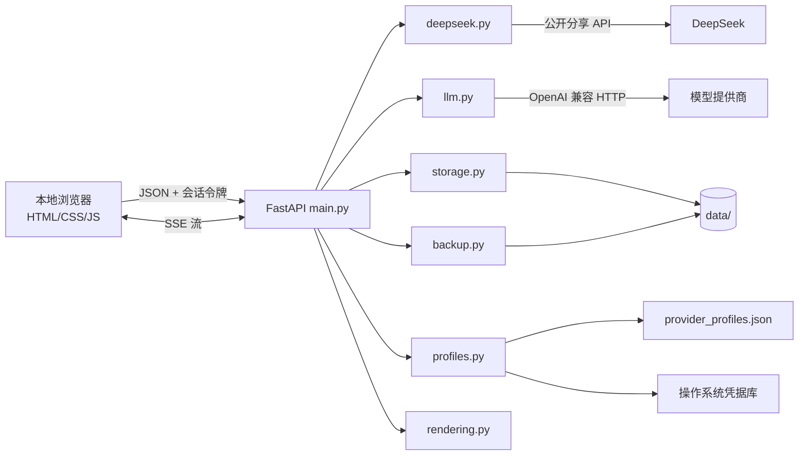
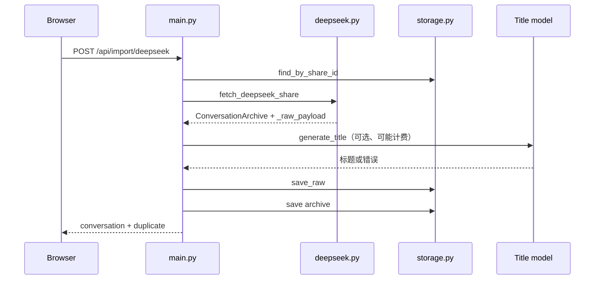

# 肥鱼 FlowChat 开发文档

本文面向维护者和贡献者，说明架构、关键数据不变量、接口、扩展方式、测试方法和安全边界。普通安装与操作请阅读 [使用教程](USER_GUIDE.md)。

## 1. 技术栈与设计目标

- Python 3.10+
- FastAPI + Uvicorn
- Pydantic v2
- HTTPX 异步 HTTP 客户端
- keyring 操作系统凭据库
- markdown-it-py + mdit-py-plugins
- latex2mathml（LaTeX 转原生 MathML）
- 原生 HTML、CSS、JavaScript，无前端构建步骤
- pytest + pytest-asyncio

设计优先级：

1. 对话数据可恢复；
2. OpenAI Chat Completions 格式兼容；
3. API Key 不进入普通文件或备份；
4. 本地启动和使用门槛低；
5. 不依赖单一模型厂商 SDK；
6. 前端无需 Node.js 工具链即可运行。

## 2. 项目结构

```text
FeiYu-FlowChat/
├─ app/
│  ├─ main.py        FastAPI 组装、路由、生命周期、SSE
│  ├─ models.py      Pydantic 数据契约和归档模型
│  ├─ deepseek.py    分享链接验证、抓取和转换
│  ├─ llm.py         OpenAI 兼容请求、流式解析、标题生成
│  ├─ chat_modes.py  厂商能力表、思考/联网参数和回退判定
│  ├─ storage.py     原子归档、版本、回收站、健康检查
│  ├─ backup.py      ZIP 清单、校验、恢复和保留策略
│  ├─ profiles.py    非密钥配置与系统凭据库
│  ├─ rendering.py   安全 Markdown/LaTeX 显示层渲染
│  ├─ config.py      路径、版本和应用常量
│  └─ errors.py      可安全返回给前端的领域错误
├─ static/
│  ├─ index.html     页面结构和对话框
│  ├─ styles.css     桌面/移动响应式样式
│  └─ app.js         浏览器状态、API 调用、SSE 与交互
├─ tests/            存储、备份、DeepSeek、LLM、API 测试
├─ docs/
│  ├─ USER_GUIDE.md
│  └─ DEVELOPMENT.md
├─ run.ps1           Windows 一键启动
├─ requirements.txt
└─ pyproject.toml
```

## 3. 组件关系



`main.py` 是 composition root，不应重新实现存储、解析或 HTTP 协议细节。新增可独立测试的业务逻辑时，优先放入对应模块。

## 4. 启动生命周期

1. 导入 `app.config`，解析项目目录和 `FLOWCHAT_DATA_DIR`；
2. `ensure_data_dirs()` 创建必要目录；
3. 构造 `ArchiveStore`、`ProviderProfileStore` 和 `BackupManager`；
4. 生成仅保存在进程内的 `SESSION_TOKEN`；
5. FastAPI lifespan 启动后台维护循环；
6. 浏览器读取 `/api/session`，后续写请求带 `X-FlowChat-Token`；
7. 后台每 5 分钟检查自动备份是否到期，并执行回收站保留策略；
8. 进程退出时取消后台任务。

后台任务异常必须写入日志，并把可展示的简短错误写入 `settings.json:last_error`，不能静默失败。

## 5. 核心数据模型

### 5.1 ConversationArchive

归档格式标识为：

```json
{
  "format": "openai-chat-completions",
  "version": "1.2"
}
```

核心不变量：

- `messages` 只放可用于模型请求的字段；
- `message_metadata` 与 `messages` 等长且按下标对应；
- 思考过程、时间戳、供应商消息 ID 和来源信息只放在 metadata；
- API Key 不得进入 `model`、`source`、metadata 或任何归档字段；
- 每次保存都会更新 `updated_at`；
- 模型生成标题后，`title_info.method == "model"`；
- 手动改名后，`title_info.method == "manual"`；
- 模型不可用时，`title_info.method == "fallback"`。

`ConversationArchive.align_metadata()` 会修复旧文件或第三方 JSON 缺失的 metadata，从而让下游代码始终依赖等长不变量。

### 5.2 OpenAIMessage

当前支持 `system`、`user`、`assistant`、`tool`。`request_dict()` 负责生成可直接发送给提供商的消息结构。

自 1.2 归档格式起，`content` 支持字符串或 OpenAI `text` / `image_url` / `file` 内容块。搜索、标题及字符估算必须使用 `text_content()`，不能对 `content` 直接调用字符串方法。图片使用 `image_url.url`，文件使用 `file.file_data`，下载成功后均为内嵌 Base64 data URL，使单个 JSON 可以迁移。旧字符串归档继续兼容。

如果未来支持完整 tool calling，需要同时扩展：

- `OpenAIMessage` 的 tool calls 字段；
- `llm.parse_completion_chunk()`；
- 前端消息渲染；
- 导入/导出兼容性测试。

### 5.3 ProviderConfig

`ProviderConfig` 是一次请求的完整配置。保存为档案时，`ProviderProfileStore.save()` 会先移除 `api_key`，再把密钥写入 keyring。

不要把解析出的完整 `ProviderConfig` 写入日志，因为它包含运行时 API Key。日志中最多记录 `provider_id`、Base URL 主机名和模型 ID。

## 6. 数据写入与恢复策略

### 6.1 原子写入

`storage._atomic_json()` 在目标目录写临时文件，执行 flush 和 `fsync`，最后通过 `os.replace()` 原子替换。调用者不要直接使用 `Path.write_text()` 覆盖活动归档。

### 6.2 历史版本

`ArchiveStore.save(create_version=True)` 会在覆盖活动文件前，把旧文件复制到 `data/versions/<conversation-id>/`。每个对话只保留最近 50 个版本。

首次创建、首次导入和从备份导入新 ID 时可以使用 `create_version=False`，因为目标不存在。

### 6.3 原始响应

DeepSeek 转换后的 `ConversationArchive` 临时携带 `source._raw_payload`。`main._import_deepseek()` 必须在保存主归档前：

1. 从 `source` 移除 `_raw_payload`；
2. 调用 `ArchiveStore.save_raw()`；
3. 把返回的路径、SHA-256 和保存时间写入 `source.raw_snapshot`。

这样主归档保持简洁，同时未来仍能基于原始响应重新解析。

### 6.4 回收站

普通删除只移动活动 JSON，不立即删除 sidecar。恢复时如果 ID 已被占用，会生成新 UUID，并复制独立的原始响应快照。

永久删除才清理原始响应、版本和附件目录。新增 sidecar 类型时，必须同步更新永久删除和备份逻辑。

## 7. DeepSeek 导入流程



`parse_share_url()` 只接受 HTTPS、`chat.deepseek.com` 和严格 `/share/<id>` 路径，避免把导入器变成任意 URL 抓取器。

DeepSeek 响应是外部、不稳定结构。修改解析时：

- 保留未知字段的原始响应；
- 不因单个未知消息角色导致整个导入失败；
- 保留 THINK 为 `reasoning_content`，不要混入回答正文；
- 为新样本补充 `tests/test_deepseek.py`。

## 8. 标题策略

标题生成是主流程之外的 best-effort 请求：

1. 先计算第一句用户消息备用标题；
2. 有可用配置时，使用同一个请求模型生成不超过 20 个汉字的标题；
3. 成功则写 `method=model` 和模型信息；
4. 任何提供商错误都保留备用标题，不能让导入或已完成回复丢失；
5. 手动重命名后不再自动覆盖。

标题请求是独立计费请求。新增批量导入入口时，UI 必须继续说明这一点。

## 9. 模型请求与 SSE

`llm.py` 不使用厂商 SDK，而是统一构造 OpenAI Chat Completions 请求。

前端模式由 `chat_modes.py` 集中判断，不在 JavaScript 内复制厂商规则。`stream_chat()` 在一次传输外包裹能力校验与有条件的单次回退，`_stream_chat_once()` 不自动重试。新增 SSE `mode_status` / `tool_activity`，档案列表包含 `capabilities`；续聊请求的 `thinking` / `web_search` 为可空布尔值。联网引用与供应商上下文放在元数据 sidecar，而非标准消息正文。详细协议、持久化规则、官方依据和扩展步骤见 [API 模式开发说明](API_MODES.md)。

Base URL 规则：

- 已以 `/chat/completions` 结尾：原样使用；
- 否则追加 `/chat/completions`。

`parse_completion_chunk()` 把不同供应商的增量或一次性消息统一为事件：

| 事件 | 主要字段 | 用途 |
| --- | --- | --- |
| `delta` | `content` | 回答文本增量 |
| `reasoning_delta` | `content` | 思考文本增量 |
| `usage` | `usage` | token 用量 |
| `response_id` | `id` | 提供商响应 ID |
| `finish` | `finish_reason` | 结束原因 |

HTTP 层再编码为 SSE：

| SSE event | 说明 |
| --- | --- |
| `accepted` | 用户消息已持久化 |
| `delta` | 回答文本 |
| `reasoning_delta` | 思考文本 |
| `done` | 助手消息、标题和 metadata 已持久化 |
| `error` | 可展示的模型或内部错误 |

聊天路由按 conversation ID 使用 `asyncio.Lock`，避免同一对话的两个回复交叉写入。不要换成全局锁，否则不同对话也会相互阻塞。

## 10. 备份格式

备份 ZIP 根目录包含数据目录的相对路径和 `manifest.json`：

```json
{
  "format": "feiyu-flowchat-backup",
  "version": 1,
  "display_name": "肥鱼 FlowChat",
  "created_at": "...",
  "files": [
    {"path": "archives/...json", "size": 123, "sha256": "..."}
  ]
}
```

恢复分为两个阶段：

1. 验证所有路径、解压总大小、ZIP CRC、manifest 格式、重复文件名、清单外文件、文件大小和 SHA-256；
2. 验证全部通过后，才按冲突策略写入目标。

必须保持“完整验证在先，写入在后”。不要边校验边恢复，否则损坏包会造成部分恢复状态。

API Key 不在备份中。更改凭据策略时应保持这一安全属性。

## 11. HTTP API

所有写接口都需要 `X-FlowChat-Token`。浏览器先调用 `/api/session` 获取 token。

### 系统与提供商

| 方法 | 路径 | 说明 |
| --- | --- | --- |
| GET | `/api/session` | 本地会话 token、名称和版本 |
| GET | `/api/health` | 进程健康 |
| GET | `/api/providers` | 内置提供商预设 |
| POST | `/api/render` | 批量渲染 Markdown/LaTeX，不改归档 |
| GET | `/api/provider-profiles` | 不含密钥的档案列表 |
| POST | `/api/provider-profiles` | 新建或更新档案 |
| DELETE | `/api/provider-profiles/{id}` | 删除档案和对应密钥 |
| DELETE | `/api/provider-profiles/keys` | 清除全部已保存密钥 |
| POST | `/api/providers/test` | 测试临时配置，真实计费 |
| POST | `/api/provider-profiles/{id}/test` | 测试已保存档案 |
| GET | `/api/provider-profiles/{id}/models` | 获取兼容模型列表 |

### 对话

| 方法 | 路径 | 说明 |
| --- | --- | --- |
| GET | `/api/conversations` | 查询和筛选摘要 |
| POST | `/api/conversations` | 新建空白归档 |
| POST | `/api/conversations/batch` | 批量整理或回收 |
| GET | `/api/conversations/{id}` | 完整归档 |
| PATCH | `/api/conversations/{id}` | 标题与整理信息 |
| DELETE | `/api/conversations/{id}` | 移入回收站 |
| GET | `/api/conversations/{id}/export` | 下载 JSON |
| POST | `/api/conversations/{id}/chat` | SSE 续聊 |
| GET | `/api/conversations/{id}/versions` | 历史版本 |
| POST | `/api/conversations/{id}/versions/{name}/restore` | 恢复版本 |

### 导入与数据保全

| 方法 | 路径 | 说明 |
| --- | --- | --- |
| POST | `/api/import/deepseek` | 单链接导入 |
| POST | `/api/import/deepseek/batch` | 最多 100 个链接 |
| POST | `/api/import/json` | OpenAI 兼容 JSON |
| GET | `/api/trash` | 回收站列表 |
| POST | `/api/trash/{name}/restore` | 恢复回收站项目 |
| DELETE | `/api/trash/{name}` | 永久删除 |
| GET | `/api/data/health` | 数据健康检查 |
| POST | `/api/data/repair` | 尝试修复 |
| GET/PUT | `/api/backups/settings` | 自动备份设置 |
| POST | `/api/backups/create` | 创建完整备份 |
| GET | `/api/backups/{name}` | 下载备份 |
| POST | `/api/backups/restore?conflict=...` | 上传并恢复 ZIP |

FastAPI 自动文档可在开发环境访问 <http://localhost:8000/docs>。

## 12. 前端状态约定

`static/app.js` 无构建步骤，主要状态集中在 `state`：

- `token`：仅内存中的本地会话 token；
- `summaries`：左侧列表摘要；
- `active`：当前完整归档；
- `profiles` / `profileId`：模型档案；
- `config`：当前非密钥偏好；
- `generating` / `abortController`：流式生成状态；
- `selectedIds`：批量操作选择。

localStorage 只能保存非密钥设置。新增字段时先判断它是否可能包含凭据、Cookie、个人数据或完整对话；这些内容不应写入浏览器存储。

前端没有虚拟 DOM。渲染外部文本时使用 `textContent`，不要把模型输出、标题或标签拼进 `innerHTML`。

富文本是一个受控例外：`/api/render` 使用禁用原始 HTML 的 CommonMark 解析器，并把 LaTeX 转成经过 XML 重序列化和标签检查的 MathML。前端只把该端点返回的结果写入消息节点；端点失败时保留已经显示的纯文本。复制消息时使用保存的原始文本，而不是渲染后的 DOM 文本。

## 13. 本地安全模型

当前安全前提是服务仅监听回环地址。

- `TrustedHostMiddleware` 只接受 localhost、127.0.0.1 和测试主机；
- 写接口验证随机会话 token；
- 有 Origin 时，只接受 localhost 或 127.0.0.1；
- DeepSeek 导入器只访问固定官方 API；
- 备份恢复拒绝绝对路径和 `..`；
- API Key 进入 keyring，浏览器和备份不保存。

这不是公网多用户认证系统。如果要监听 `0.0.0.0`，至少需要新增：

- 用户认证与会话管理；
- HTTPS；
- CSRF 策略重新设计；
- API 限流；
- SSRF/出站目标控制；
- 多用户数据隔离；
- 审计日志和密钥权限模型。

## 14. 开发环境

```powershell
python -m venv .venv
.\.venv\Scripts\Activate.ps1
python -m pip install -r requirements-dev.txt
```

开发启动：

```powershell
$env:FLOWCHAT_DATA_DIR = "$env:TEMP\feiyu-flowchat-dev"
python -m uvicorn app.main:app --host 127.0.0.1 --port 8000 --reload
```

使用独立开发数据目录，避免手工测试污染真实归档。

## 15. 测试

运行全部测试：

```powershell
python -m pytest -q
```

基础语法检查：

```powershell
python -m compileall app
node --check static\app.js
```

测试职责：

| 文件 | 覆盖重点 |
| --- | --- |
| `test_deepseek.py` | URL 白名单、消息与思考转换 |
| `test_llm.py` | URL 拼接、流解析、计费测试请求体 |
| `test_chat_modes.py` | 厂商模式映射、单次回退、不重复计费重试、引用与多轮归档 |
| `test_storage.py` | OpenAI 格式、版本、回收站、ID 冲突 |
| `test_profiles.py` | Key 不落盘、keyring 生命周期 |
| `test_backup.py` | 完整恢复、副本 ID、raw、checksum 篡改 |
| `test_api.py` | SSE 写入、模型标题、raw 快照 |
| `test_models.py` | metadata 不变量、批量请求规范化 |
| `test_rendering.py` | Markdown、四种公式分隔符、HTML 转义、渲染 API |

涉及文件写入的测试必须使用 `tmp_path`。涉及外部 HTTP 的测试使用 HTTPX MockTransport 或 monkeypatch，不调用真实服务商。

## 16. 添加新提供商预设

预设只影响前端默认值，不应引入厂商专用 SDK。

1. 在 `app/llm.py:PROVIDER_PRESETS` 添加 `id`、`name`、`base_url`、`model`、`hint`；
2. 确认目标支持 Bearer Token 和 Chat Completions；
3. 若需要额外字段，优先让用户通过 `extra_body` 配置；
4. 用 MockTransport 添加请求体测试；
5. 在使用教程说明特殊限制；
6. 不要把真实 Key 或账号信息提交到仓库。

如果供应商响应与 OpenAI 格式有小差异，应在 `parse_completion_chunk()` 做最小、可测试的兼容；不要把厂商判断散落到路由和前端。

## 17. 代码与注释约定

- 公共类、关键函数和模块写 docstring，描述职责与不变量；
- 行内注释解释“为什么”，不要复述代码字面行为；
- 文件写入优先经过 storage/backup 的原子方法；
- 领域错误使用 `FlowChatError` 子类，避免向 UI 暴露堆栈和密钥；
- 意外异常写服务器日志，前端只收到稳定错误消息；
- API 请求体优先定义 Pydantic 模型，不手工解析任意 JSON；
- 前端外部数据使用 `textContent`；
- 新增功能同时更新 README、使用教程、开发文档和对应测试。

## 18. 调试建议

### 查看归档写入

设置独立 `FLOWCHAT_DATA_DIR`，完成一个操作后检查 `archives/` 和 `versions/`。不要用真实 API Key 创建可提交的测试数据。

### 调试 SSE

浏览器开发者工具的 Network 中查看 `/chat` 请求。事件顺序通常是：

```text
accepted → reasoning_delta/delta... → done
```

如果只有 `accepted → error`，用户消息已经落盘，错误发生在提供商请求阶段。

### 调试 DeepSeek 结构变化

使用不含敏感信息的分享样本，把原始响应匿名化后转成固定测试 fixture，先为新结构写失败测试，再调整 `parse_share_payload()`。

### 调试备份

不要先用真实数据测试恢复。使用临时数据目录创建几个归档、版本和回收站项目，创建 ZIP 后恢复到第二个临时目录并执行健康检查。

## 19. 发布检查清单

- [ ] `APP_VERSION` 与 `pyproject.toml` 一致；
- [ ] `python -m compileall app` 通过；
- [ ] `node --check static/app.js` 通过；
- [ ] 全部 pytest 通过；
- [ ] localhost 首页、移动侧栏、设置和数据保全中心可用；
- [ ] 使用临时目录验证创建、导入、续聊和导出；
- [ ] 备份可在空目录完整恢复且健康检查通过；
- [ ] API Key 未出现在 JSON、日志、测试快照和 ZIP 中；
- [ ] 标题生成失败仍保留对话；
- [ ] README、使用教程和开发文档已同步。

## 20. 当前边界

- DeepSeek 分享 API 不是稳定公开契约，结构变化需要适配；
- 自动下载仅覆盖已验证的 DeepSeek 文件域名，每个附件最多 20 MB、单次合计 60 MB；失效签名和未公开文件只能保留元信息；
- 图片原图不可用时保存预览并标注，不能当作无损原图备份；
- 仅保留来源 OCR 文字并提取常见文档文本，不内置图像 OCR 引擎；
- tool calling 只保留基础消息字段，尚未实现完整工具调用 UI；
- token 数是字符估算，准确用量以提供商返回为准；
- 自动备份依赖程序持续运行，不是系统级定时任务；
- 当前安全模型只面向单机单用户 localhost。

## 21. 附件管线与前端扩展

`app/attachments.py` 的 `share_attachments()` 被 DeepSeek 解析器调用：识别真实分享 API 的 `fragments[].type = FILE` / `files[]`，以及旧版侧栏附件字段。`signed_path` 按 DeepSeek 公开前端使用的 `https://files.deepseeksvc.com/api` 文件服务解析。下载原文件使用 `ty=r`；图片被拒绝时尝试 `ty=p`，记录 `variant=preview`。

导入服务在标题生成前调用 `preserve_attachments()`。每个附件独立失败降级，不能丢弃纯附件消息。元数据位置为 `message_metadata[i].details.attachments`：

- `original`、`source_url`：来源字段及链接；原始响应另存 raw 快照。
- `status`、`error`、`variant`：保存状态、失败原因、原件/预览区别。
- `content_index`：对应消息中二进制内容块的位置。
- `text_index`：用于上下文的附件说明/识别文字块位置；UI 用折叠面板展示它，避免在气泡中重复打印。
- `text`、`text_source`：公开 OCR 或本地提取结果；`size`、`sha256` 描述实际保存的字节。

下载器限定 HTTPS、指定域名、标准端口，不跟随重定向；不会读取用户登录 Cookie。前端只从 `/api/conversations/{id}/attachments/{message_index}/{part_index}` 获取归档中已保存的数据。接口没有路径或 URL 代理参数，只有栅格图片可内联，其他文件以下载方式返回，并设置 `nosniff` 和 sandbox。

`extract_text()` 使用 pypdf 读取 PDF 文字层（包括空用户密码 PDF），通过 ZIP/XML 读取 DOCX，其他文本尝试 UTF-8 / GB18030。提取限前 100 页、10 万字符；提取失败仍保留二进制。扫描件需另选视觉/文件模型，不能把文字提取标成 OCR。

`ProviderConfig.attachment_mode` 默认为 `text`。`llm._body()` 只转换请求副本，按 `text/images/files` 过滤发送内容；DeepSeek 文件内容块按其官方请求体转换为平铺的 `file_data` / `filename`，其他 OpenAI 兼容接口保留嵌套 `file`。不要把 API 上传返回的供应商 file_id 放入可迁移归档。

前端 `messageText()` 处理两种内容形态；`renderAttachments()` 负责下载、图片灯箱和识别文字面板。草稿仅放当前标签页 sessionStorage，按对话 ID 分开；阅读跟随状态由 `followTail` 控制。服务端归档仍是消息的权威来源。

回归测试：`tests/test_attachments.py` 覆盖纯附件消息、图片预览降级、OCR 保留、受限地址、空用户密码 PDF、提供商模式转换、JSON/ZIP 迁移和本地附件接口。真实分享样例验证在隔离的数据目录中进行，不将用户文件放入测试夹具。
